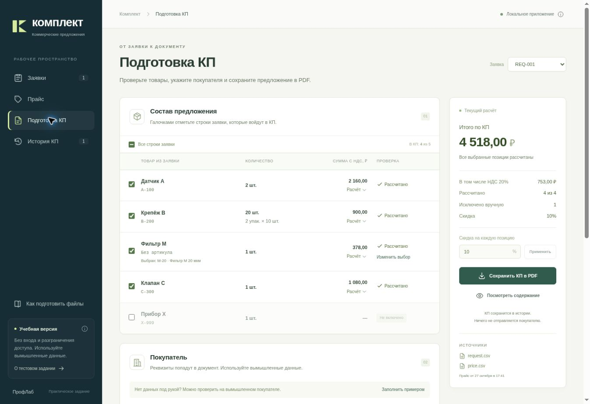

# Комплект

Локальное приложение к тестовому заданию ПрофЛаб: из заявки и прайса получается черновик коммерческого предложения. Его можно проверить по строкам и скачать в PDF.

Лицензия MIT.

Текст задания — [docs/task.txt](docs/task.txt). Учебные файлы лежат в [data/](data/): `request.csv` и `price.csv`, кодировка UTF-8, разделитель `;`.



На снимке фильтр уже выбран, у клапана указана цена, прибор X исключён из документа. На исходных файлах без этих правок подытог равен 3 060 ₽.

## Запуск

Нужен Python 3.13. Интерфейс уже собран, Node.js для проверки не нужен. Входа в приложение нет: кто открыл эту копию, видит и меняет те же данные. В формах только вымышленные реквизиты.

### Windows

1. Распакуйте архив через «Извлечь всё». Из открытого ZIP файлы не запускайте.
2. Если Python 3.13 ещё нет, поставьте [Windows installer (64-bit)](https://www.python.org/downloads/windows/) выпуска 3.13.x.
3. В папке проекта откройте `start.cmd`.
4. При первом запуске скрипт скачает компоненты. На этом шаге нужен интернет.
5. Браузер откроется сам. Если нет — перейдите на [http://127.0.0.1:8765](http://127.0.0.1:8765).

Окно запуска оставьте открытым. Остановка — Ctrl+C в этом окне. Заявки, прайс и история КП лежат в `var` и сохраняются между запусками.

### macOS и Linux

В папке проекта, при установленном Python 3.13:

```bash
bash start.sh
```

Адрес тот же: [http://127.0.0.1:8765](http://127.0.0.1:8765).

## Проверка исходных файлов

Файлы сначала не правьте. Так видны три нерешённые строки.

1. Раздел **Заявки**. Выберите `data/request.csv` или нажмите «Скачать образец». В окне «Файл проверен» нажмите **Сохранить заявку**. До этого нажатия данные не меняются.
2. Раздел **Прайс**. Загрузите `data/price.csv`. Приложение предупредит, что у клапана C нет цены. Нажмите **Сохранить прайс**. Цену пока не заполняйте.
3. Раздел **Подготовка КП**, заявка **REQ-001**. По умолчанию в документ входят все пять строк.

| Позиция | Результат | Сумма с НДС |
| --- | --- | ---: |
| Датчик A, A-100 | Найден, цена есть | 2 160,00 ₽ |
| Крепёж B, B-200 | 20 штук = 2 упаковки по 10 | 900,00 ₽ |
| Фильтр М | В прайсе два подходящих товара | не рассчитана |
| Клапан C, C-300 | Товар есть, цены нет | не рассчитана |
| Прибор X, X-999 | Артикула нет в прайсе | не рассчитана |

Подытог двух рассчитанных строк — **3 060,00 ₽**, в том числе НДС **510,00 ₽**. Подпись «Подытог рассчитанных позиций» означает, что это ещё не сумма всей заявки. Кнопка **Расчёт** под строкой показывает исходную цену, источник, скидку, единицу продажи и НДС.

## Упаковки, скидка и НДС

Количество в заявке задано в штуках. Число единиц продажи — целая часть от деления штук на `pack_size`. Остаток не округляется вверх: 21 штука при упаковке 10 не превращается в 3 упаковки, строка просит согласовать количество.

Скидка по умолчанию 10% снимается с цены одной единицы продажи. Сумма округляется до копеек. Потом учитывается НДС 20%:

- `price_basis=net` — после скидки цена умножается на 1,20.
- `price_basis=gross` — НДС уже в цене, второй раз не прибавляется.

Сумма строки — цена с НДС, умноженная на число единиц продажи. НДС внутри суммы — `сумма × 20 / 120`, тоже до копеек. В подытог входят только рассчитанные строки.

Датчик A: 2 штуки, 1 000 ₽ без НДС. Минус 10% = 900 ₽, плюс НДС = 1 080 ₽ за штуку. Две штуки — 2 160 ₽, в том числе НДС 360 ₽.

Крепёж B: 20 штук и упаковка 10 дают 2 упаковки. Цена 500 ₽ уже с НДС. Минус 10% = 450 ₽ за упаковку. Две упаковки — 900 ₽, в том числе НДС 150 ₽.

Пустая цена остаётся пустой. Ноль в ячейке означает бесплатную позицию и участвует в расчёте.

Ставка 20%, рубли и скидка 10% заданы заданием. Скидку можно сменить в форме. Другую ставку НДС и другую валюту файлы не задают.

## Что сделать дальше по заданию

**Фильтр М.** «Выбрать товар». В списке M-10 и M-20. Приложение само товар не назначает. Исходное название заявки сохраняется.

**Клапан C.** «Указать цена». Цена за штуку без НДС и источник, например «Учебная цена для проверки». Правка попадает в текущий прайс и в расчёт всех заявок с этим товаром.

**Прибор X.** «Нет в прайсе». Строку можно оставить пустой или подтвердить замену товаром из прайса. Одного ввода цены недостаточно: сначала нужен сам товар.

Галочка слева включает строку в это КП. Снятые строки в PDF видны как не вошедшие в документ.

**Покупатель.** Для готового КП в этом примере нужны название, ИНН и адрес. Кнопка «Заполнить примером» подставляет вымышленные значения, затем нажмите «Сохранить реквизиты». Тот же набор можно ввести вручную: ООО «Северный завод Демо», ИНН 9900000000, адрес «Учебный город, улица Примеров, дом 1». ИНН проверяется по контрольной цифре, реестр компаний не опрашивается. Недописанные поля и текст скидки сохраняются сами и возвращаются после обновления страницы.

Продавец задан: ООО «Ладога Комплект Демо». Название, телефон и реквизиты вымышлены, для оплаты не годятся. Предмет предложения и условия во всех документах одинаковые.

**PDF.** «Посмотреть содержание», затем «Сохранить КП в PDF». Если остались пустые строки или нет обязательных реквизитов, приложение предложит дополнить данные или сохранить черновик. В черновике сумма названа подытогом, пустые деньги не заменяются нулём. Файл скачивается на компьютер и появляется в «Истории КП». Покупателю он сам не отправляется.

Повтор того же нажатия «Сохранить КП», пока страница не обновила данные, возвращает уже созданный документ.

## Смена цены и повтор заявки

В `price.csv` замените цену A-100 с 1000 на 1100, загрузите файл через «Загрузить новый прайс» и подтвердите замену. При тех же пяти строках, скидке 10% и без уточнения трёх пустых позиций подытог станет **3 276,00 ₽**, НДС **546,00 ₽**. Датчик даст 2 376,00 ₽, крепёж останется 900,00 ₽.

Ту же цену можно вписать кнопкой «Изменить» в разделе «Прайс».

Уже сохранённый PDF останется со старыми 3 060,00 ₽. Новый документ выпускается отдельно.

Повторная загрузка файла с `request_id` REQ-001 обновляет ту же заявку. Второй записи с этим номером не появляется. Тот же файл не сбрасывает уже сделанный выбор. Изменённый файл с тем же номером заменяет строки и сбрасывает подбор товаров; покупатель и скидка остаются.

Скидка 15% на исходных файлах, без уточнения пустых строк, даёт подытог **2 890,00 ₽**, НДС **481,67 ₽**. Для остальных проверок верните 10%.

Новый прайс удаляет прежние товары. Пропадут вручную введённые цены и соответствия строк заявки товарам. Перед заменой это написано в окне подтверждения. Выпущенные PDF при этом не удаляются.

## Цена не из прайса

Поиск цены в интернете в проверку не входит и в приложении не делается. Такую цену нужно хранить отдельно от подтверждённой: источник, дата, валюта, единица продажи, размер упаковки, НДС, наличие. В сумму КП она попадает после явного подтверждения. Похожего названия и числа на странице для этого мало.

## Границы примера

- Нет регистрации, ролей и отдельных компаний. Данные одной запущенной копии общие.
- Принимается CSV UTF-8 с разделителем `;` и столбцами из [docs/files.md](docs/files.md). Excel, PDF и архив отклоняются до изменения данных. Файл с ошибкой в строке не применяется частично. Первые 50 ошибок показываются со строкой и полем. Номер строки включает заголовок.
- Нет остатков, резервов и срока поставки.
- Продавец, предмет и условия не редактируются.
- Рабочая база — `var/komplekt.sqlite3`. Папка `data` содержит только образцы. Чтобы сохранить копию, остановите приложение и скопируйте `var`. Файл базы вручную не правьте.

Готовый пример PDF на исходных файлах: [output/pdf/komplekt-example.pdf](output/pdf/komplekt-example.pdf).

## Если не открылось

| Что видно | Что сделать |
| --- | --- |
| Python 3.13 не найден | Поставить 3.13 и снова открыть `start.cmd` |
| Долго качаются компоненты | Дождаться окончания и проверить интернет. При обрыве запустить скрипт ещё раз |
| Вкладка пустая | Оставить окно запуска открытым и открыть [127.0.0.1:8765](http://127.0.0.1:8765) |
| Страница перестала отвечать | Снова запустить `start.cmd` или `start.sh` |
| «Данные изменились» | Обновить страницу и повторить действие |
| Старый PDF не совпал с новым расчётом | Выпустить новое КП. Прежний файл хранит прежний снимок |
| Браузер не скачал файл | «История КП» → просмотр → «Открыть PDF» |

Если скрипт остановился с другой ошибкой, сохраните текст из окна запуска.

Заметки по коду — [docs/development.md](docs/development.md). Для проверки задания достаточно шагов выше.
